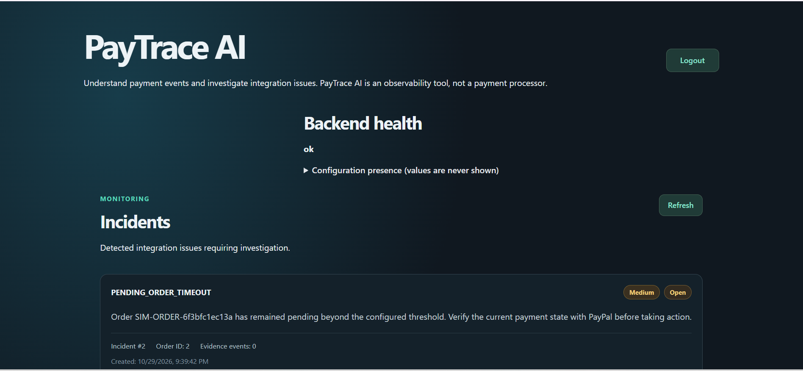
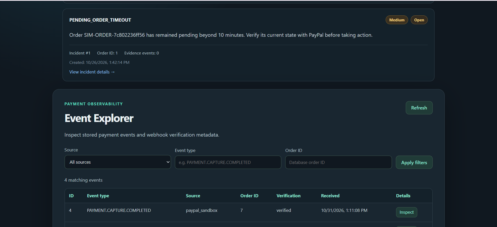
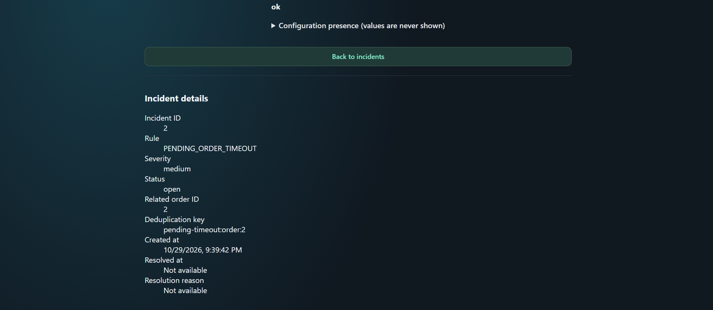
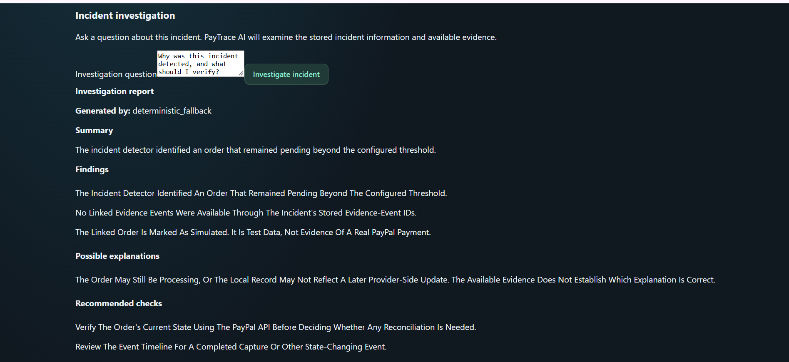
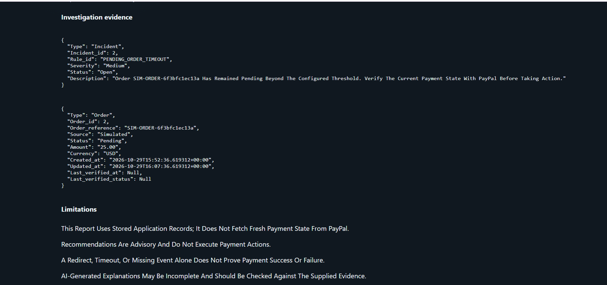

# PayTrace AI

AI-powered payment debugging workbench for developers integrating PayPal.

Work in progress for the "Build What's Next with PayPal and AI" hackathon.
# PayTraceAI 💳🤖

### AI-Powered PayPal Payment Monitoring and Investigation Platform

PayTraceAI is an AI-assisted payment monitoring and investigation platform built to help developers and businesses understand payment issues, monitor transaction events, and investigate unusual payment behavior.

Instead of manually examining payment records and webhook events, PayTraceAI organizes payment information, detects potential incidents, and generates structured investigation reports with supporting evidence.

## 🚀 Live Demo

- **Frontend:** https://paytrace-ai-frontend.onrender.com
- **Backend API:** https://paytrace-ai-api.onrender.com
- **API Documentation:** https://paytrace-ai-api.onrender.com/docs

## 🎯 Problem Statement

Payment systems generate multiple events during the transaction lifecycle. When payments remain pending, events cannot be matched, or payment statuses become inconsistent, investigating the issue can be difficult.

PayTraceAI aims to simplify this process by bringing payment monitoring, incident detection, event verification, and AI-assisted investigation into one dashboard.

## ✨ Key Features

- **PayPal Integration:** Create and monitor PayPal Sandbox orders.
- **Payment Lifecycle:** Track order creation, approval, and capture.
- **Webhook Verification:** Verify incoming PayPal webhook signatures before accepting events.
- **Event Explorer:** Review payment events and their verification status.
- **Incident Detection:** Identify potential payment issues using rule-based detection.
- **AI-Assisted Investigation:** Generate structured reports containing summaries, findings, hypotheses, and recommended checks.
- **Incident Management:** Review and resolve incidents with recorded resolution information.
- **Admin Authentication:** Protect dashboard and administrative API endpoints.
- **Simulation Engine:** Simulate payment scenarios to test incident detection.

## 🧠 AI Investigation

PayTraceAI combines deterministic investigation logic with optional OpenAI-powered summary enhancement.

The investigation system uses stored incident, order, and payment-event evidence to produce:

- Investigation summary
- Findings
- Possible hypotheses
- Recommended verification steps
- Evidence and limitations

AI-generated summaries do not replace verified payment evidence. The system is designed to assist investigation, not make autonomous financial decisions or perform payment operations.

## 🏗️ Technology Stack

| Component | Technology |
|---|---|
| Frontend | React, Vite, JavaScript |
| Backend | Python, FastAPI |
| Database | SQLAlchemy, SQLite / PostgreSQL |
| Payment Integration | PayPal REST API |
| AI | OpenAI API (optional) |
| Authentication | Admin API key |
| Testing | Pytest |
| Deployment | Render |

## 🏛️ Architecture

```text
              User
               |
               v
       React Dashboard
               |
               v
          FastAPI
               |
       +-------+--------+
       |       |        |
       v       v        v
    PayPal  Incident  Investigation
     API    Detection    Service
       |       |        |
       v       +---+----+
    Webhooks       |
       |           v
       +------> Database
                   |
                   v
             Event Explorer
```

## 🔐 Security

- Administrative endpoints require an admin API key.
- PayPal webhook signatures are verified before webhook events are accepted.
- Sensitive credentials are stored in environment variables.
- Raw webhook payloads are not exposed through the event listing API.
- The AI investigation service is advisory and does not execute payment operations.

## 🧪 Testing

The backend test suite most recently completed with:

**61 tests passed.**

Tests cover API behavior, order handling, incident detection, investigation, simulations, event handling, and webhook verification.

## ⚙️ Local Setup

### 1. Clone the repository

```bash
git clone https://github.com/jeev-17/PayTraceAI.git
cd PayTraceAI
```

### 2. Backend setup

```bash
cd backend
python -m venv .venv
```

Activate the environment on Windows:

```powershell
.venv\Scripts\Activate.ps1
```

Install dependencies:

```bash
pip install -r requirements.txt
```

Configure the required environment variables using the provided `.env.example`. Never commit your actual `.env` file or credentials.

Start the backend:

```bash
uvicorn app.main:app --reload
```

### 3. Frontend setup

Open another terminal:

```bash
cd frontend
npm install
npm run dev
```

Configure the frontend API URL using the frontend environment example.

## 📌 Project Status

PayTraceAI is deployed with PayPal Sandbox integration, administrative authentication, webhook verification, payment event tracking, incident detection, and AI-assisted investigation.

**Payment testing:** PayPal Sandbox.

## 👨‍💻 Author

Developed independently as a PayPal + AI hackathon project.

**GitHub:** https://github.com/jeev-17/PayTraceAI
## Application Screenshots

### 1. PayTraceAI Dashboard


### 2. PayPal Event Explorer


### 3. Incident Details


### 4. AI Investigation Report


### 5. Investigation Evidence and Transparency
